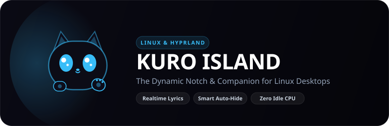

# KuroNotch 🐱 (Kuro Island • 黒アイランド)

<p align="center">
  
</p>

<p align="center">
  <strong>The Dynamic Island & Companion for Linux & Hyprland</strong><br>
  <em>Native Wayland • Quickshell 0.3.1 • Zero Idle CPU • 100% Open Source</em>
</p>

<p align="center">
  
  
  
  
  
</p>

---

## ✨ Kenalin: Kuro (クロ)

**Kuro** adalah maskot kucing bayangan obsidian yang hidup di dalam notch kamu. Kuro punya berbagai ekspresi dinamis yang bereaksi langsung terhadap aktivitas desktop kamu:

| State | Ekspresi Wajah | Kapan Muncul? |
| :--- | :---: | :--- |
| **Normal / Greet** | `(*_*)` | Saat menyapa atau santai, dengan kedipan ramah dan lambaian tangan. |
| **Music Playing** | `(^_^)` + ♪ | Saat lagu diputar via MPRIS, lengkap dengan floating music note & headphone. |
| **Pomodoro Focus** | `(｀・ω・´)` | Saat timer fokus berjalan, mengenakan headband merah penambah semangat! |
| **Idle / Sleep** | `(-_-)` + zZ | Saat desktop idle beberapa saat tanpa aktivitas media. |

> Klik Kuro di Settings Modal untuk memicu animasi lompat gembira dan lambaian tangan! 👋

---

## 🚀 Fitur Unggulan

### 1. 3 Preset Morphing Notch
Pilih gaya tampilan yang paling cocok dengan setup desktop kamu:
- **Notch**: Menempel mulus di tepi atas layar dengan kurva obsidian khas Apple.
- **Pill**: Floating pill modern melayang di tengah atas layar.
- **Micro-Strip**: Garis minimalis 4px untuk setup ultra-clean.

### 2. Real-time Synced Lyrics & Cava Visualizer
- Lirik lagu sinkron kata-per-kata secara realtime (LRC format) via MPRIS.
- **Cava Audio Spectrum** visualizer langsung menari di bawah lirik.
- **Adaptive Album Glow**: Ambient glow di belakang notch berubah warna otomatis mengikuti palet cover album musik yang sedang diputar.
- **Zero Idle CPU**: Cava visualizer otomatis tidur saat musik di-pause/stop.

### 3. Smart Auto-Hide (Tab Browser Aman!)
- Saat membuka browser (Firefox, Chromium, Zen, Brave) atau window yang dimaksimalkan, notch otomatis mengecil menjadi **sensor strip 4px**.
- **100% Click-Through**: Tab browser dan tombol navigasi di bagian atas layar bebas diklik tanpa terhalang notch!

### 4. Dynamic OSD & Privacy Dots
- Slider Volume dan Brightness bergaya Apple Dynamic Island yang muncul seketika saat tombol multimedia ditekan.
- **Privacy Dots**: Titik indikator hijau saat mikrofon aktif, dan titik merah saat screen recording (OBS / wf-recorder) aktif.

### 5. Multi-Feature Card Deck & Morphing Dock Dots
- **📂 Drag-and-Drop File Shelf**: Tarik file apa saja ke notch untuk disimpan sementara atau di-copy instan (`text/uri-list`).
- **🍅 Pomodoro Timer**: Timer fokus 25/5 menit dengan suara chime lembut.
- **🖼️ Wallpaper Switcher**: Ganti wallpaper desktop langsung dari notch dengan integrasi swww dan sinkronisasi Pywal.
- **📋 Clipboard Stash (`cliphist`)**: Akses riwayat clipboard teks dan thumbnail gambar dengan cepat.
- **✨ Morphing Dock Dots**: Titik indikator di bagian bawah notch otomatis berubah bentuk menjadi icon kategori saat di-hover lengkap dengan tooltip deskriptif.

---

## 🛠️ Instalasi Cepat (1-Command)

Pastikan kamu menggunakan **Linux Wayland** dengan **Hyprland** dan **Quickshell 0.3.1**.

### Opsi A: 1-Liner Otomatis (Direkomendasikan)
```bash
curl -sSL https://raw.githubusercontent.com/putrarawr/KuroNotch/main/scripts/install.sh | bash
```

### Opsi B: Clone Manual
```bash
git clone https://github.com/putrarawr/KuroNotch.git ~/.config/quickshell/island-notch
cd ~/.config/quickshell/island-notch
./scripts/install.sh
```

Installer otomatis akan:
1. Menyiapkan direktori state dan cache (`~/.local/state/island-notch/`).
2. Menautkan konfigurasi Quickshell (`~/.config/quickshell/island-notch`).
3. Memasang binary wrapper (`~/.local/bin/island-notch` & `~/.local/bin/kuronotch`).
4. Mengonfigurasi autostart pada `~/.config/hypr/hyprland.conf`.
5. Menyinkronkan integrasi desktop dan swww wallpaper.

---

## ⌨️ Pintasan Keyboard & Kontrol

| Shortcut / Aksi | Fungsi |
| :--- | :--- |
| `Super + Alt + N` | Buka / tutup (expand / collapse) Kuro Island |
| `Super + Alt + Shift + N` | Buka Settings Modal |
| `Shift + Mouse Wheel` | Pindah halaman carousel (Media ↔ Shelf ↔ Pomodoro ↔ Clipboard ↔ Notif) |
| `Hover Dock Dots` | Preview icon dan judul kategori halaman |
| `Right Click Notch` | Buka menu aksi cepat |
| `Klik Maskot Kuro` | Lambaian tangan dan sapaan interaktif |

---

## 📄 Lisensi

Didistribusikan di bawah lisensi **GPL-3.0**. Dibuat dengan cinta untuk komunitas Linux & r/unixporn!
